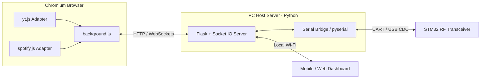
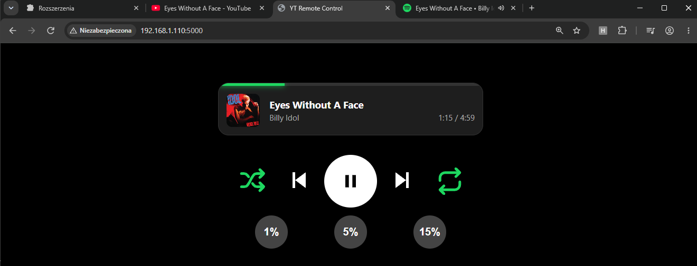
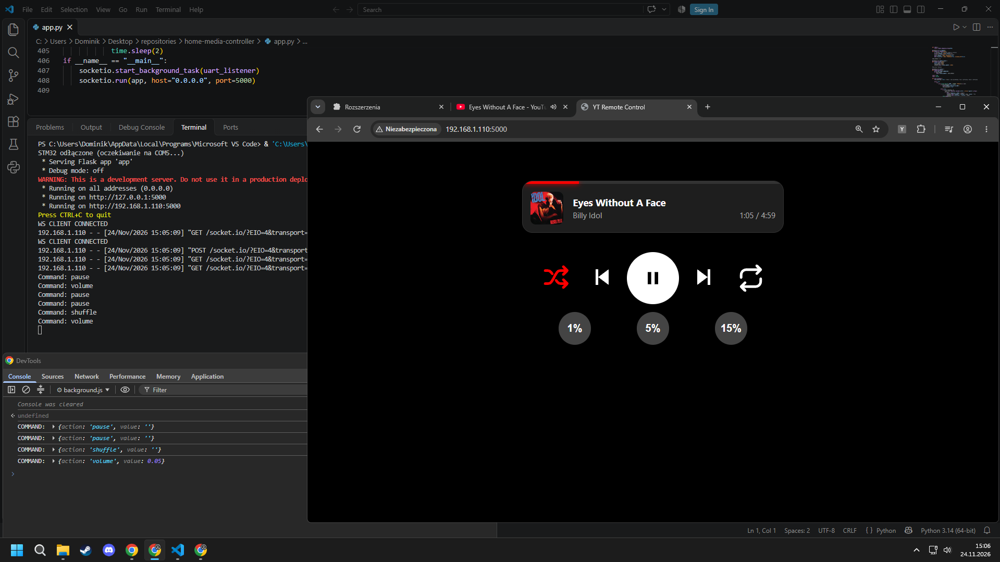

# Home Media Controller (Host & Web Dashboard)

A low-latency, local-network media controller and state synchronization server built with **Python (Flask + Socket.IO)** and a custom **Chromium Browser Extension**. 

Designed to seamlessly bridge web media players (**YouTube** & **Spotify**) with a responsive mobile web dashboard and a dedicated **STM32 RF Hardware Remote** *(companion hardware repository – coming soon)*.

---

## Motivation & Problem Statement

During fast-paced, competitive gaming sessions (e.g., *Rust*), alt-tabbing out of the game or unlocking a smartphone to pause or skip a track introduces unacceptable latency and breaks focus. 

Existing solutions either rely on heavy cloud APIs or lack instantaneous, hardware-level feedback. This project solves the problem by:
1. Extracting real-time playback state directly from the browser DOM with minimal CPU overhead.
2. Hosting a lightweight local **Flask-SocketIO** hub (`192.168.x.x:5000`) for instant multi-device synchronization (smartphones, secondary PCs).
3. Preparing a deterministic binary serial bridge (`pyserial`) for a custom **STM32 + RF** physical remote control.

---

## System Architecture



### Key Architectural Decisions
* **Modular Player Adapters (`yt.js`, `spotify.js`):** Refactored from a monolithic `content.js` script into isolated, platform-specific parsers. Adding future platforms (e.g., SoundCloud, Apple Music) requires zero changes to the core server logic.
* **Automatic Active-Player Detection:** Automatically switches UI themes (Spotify Green / YouTube Red) and routes control commands exclusively to the currently active media source.
* **Event-Driven + Lightweight Sync:** Heavy metadata (track title, artist, album art) is pushed only upon track changes, while lightweight playback ticks (`isPlaying`, timestamps) synchronize the UI smoothly.

---

## Preview & Demo

| Spotify Mode (Web UI) | YouTube Mode (Web UI) |
| :---: | :---: |
|  |  |

<!-- * **Live Demo (YouTube & Spotify Auto-Switching):** [Watch Unlisted Video on YouTube](https://youtube.com...) *(No audio)* -->

---

## Tech Stack

* **Backend:** Python 3, Flask, Flask-SocketIO, PySerial
* **Browser Extension:** JavaScript (ES6+), Chrome Extension Manifest V3
* **Frontend Dashboard:** HTML5, CSS3 (Dynamic Theme Variables), Vanilla JS, Socket.IO Client

---

## Getting Started

### 1. Start the Flask Server
```bash
git clone https://github.com/dominik-stanczyk/home-media-controller
cd home-media-controller
pip install flask flask-socketio pyserial
python app.py
```
The dashboard will be accessible across your local network at `http://<YOUR-LOCAL-IP>:5000`.

### 2. Load the Browser Extension
1. Open Chrome / Brave / Edge and navigate to `chrome://extensions/`.
2. Enable **Developer mode** in the top right corner.
3. Click **Load unpacked** and select the `extension/` folder from this repository.

---

## Progression & Roadmap

More detailed logs, architecture iterations, and milestone videos are archived in the [`progression/`](progression/) directory:

* [x] **REV 1.0:** Core Flask server & optimized YouTube DOM parser (`content.js`).
* [ ] **REV 1.1:** Modular architecture refactor + Spotify support (`spotify.js`) & dynamic UI theming.
* [ ] **REV 1.2:** Binary packet framing (`struct` + CRC16) & `pyserial` integration for STM32 (`COM` port).
* [ ] **REV 2.0:** Wireless RF bridge integration with custom STM32F4 hardware remote.
* [ ] **Future Ideas:** System-level Audio Ducking (pycaw) to automatically lower music volume during voice chat or game audio spikes.