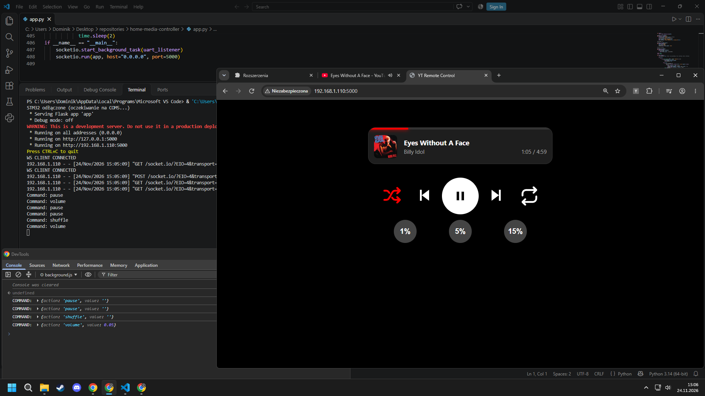

# REV 1.0 – Core Flask Server & YouTube Integration

**Status:** Completed  
**Scope:** Local WebSocket server, Chrome Extension (`background.js` + YouTube DOM parser), and initial serial port listener thread (`COM5`).

---

## Overview
The first working revision establishes the core communication pipeline between the browser extension and the local host server. At this stage, the system supports **YouTube** playback control and real-time state synchronization across local network clients (PC / smartphone via `192.168.1.110:5000`).

### Key Features Implemented
* **Flask + Socket.IO Backend (`app.py`):** Event-driven architecture broadcasting playback state updates (`isPlaying`, track metadata, timestamps) and relaying control commands with minimal overhead.
* **Optimized YouTube Parser:** Lightweight DOM observer extracting track title, artist, album thumbnail, and playback progress (`1:05 / 4:59`) without polling bloat.
* **Command Relay (`background.js`):** Instant execution of `play/pause`, `next/prev`, `shuffle`, `repeat`, and quick volume presets (`1%`, `5%`, `15%`).
* **Hardware-Ready Serial Thread:** Background `uart_listener` task initialized and polling for the STM32 receiver (`COM5`) to bridge physical RF remote inputs in upcoming revisions.

---

## System Verification & Demo

*End-to-end test showing the Flask server terminal, background service worker command logs, and the responsive Web UI controlling YouTube playback.*

<!--* **Video Demonstration:** [Watch REV 1.0 YouTube Control Demo (Unlisted YouTube Link)](#) -->

---

## Known Limitations (Addressed in REV 1.1)
* Monolithic extension script structure (`content.js`) tightly coupled to YouTube DOM selectors.
* Lack of Spotify player support and automatic active-platform switching.
