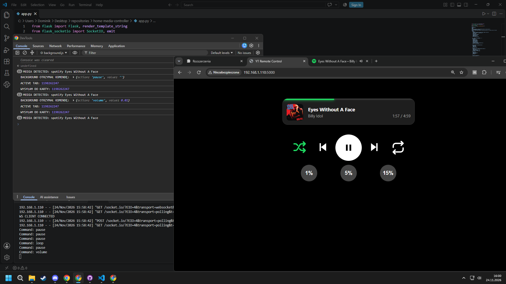

# REV 1.1 – Modular Extension Architecture & Spotify Support

**Status:** Completed  
**Scope:** Refactoring monolithic `content.js` into isolated platform adapters (`yt.js`, `spotify.js`), automatic active-player detection, and dynamic UI theming.

---

## Overview
This revision decouples the browser extension's DOM parsing logic from a single platform and introduces full **Spotify Web Player** support alongside **YouTube**. The host server (`app.py`) and web dashboard now automatically detect which media player is actively running, adjust the UI accent theme accordingly, and route all control commands exclusively to that source.

### Key Changes & Features Implemented
* **Modular Adapter Refactor (`yt.js` & `spotify.js`):** Removed the monolithic `content.js` script and split platform-specific DOM selectors and state observers into standalone files. Adding future platforms (e.g., SoundCloud, Apple Music) now requires zero modifications to the core routing logic.
* **Automatic Active-Player Switching:** Implemented priority/state arbitration in `background.js` and `app.py` to seamlessly switch control focus between YouTube and Spotify without manual user intervention.
* **Dynamic UI Theming:** Updated the web dashboard frontend to dynamically swap CSS accent variables (**Spotify Green** `#1DB954` vs. **YouTube Red** `#FF0000`) based on the currently active media source.
* **Cross-Platform Command Parity:** Unified `play/pause`, `next/prev`, `shuffle`, `repeat`, and quick volume presets (`1%`, `5%`, `15%`) across both players.

---

## System Verification & Demo

*Web dashboard automatically switching to Spotify theme and displaying real-time metadata, album artwork, and playback progress.*

<!-- * **Video Demonstration:** [Watch REV 1.1 Spotify & Auto-Switching Demo (Unlisted YouTube Link)](#) -->

---

## Next Steps (Planned for REV 1.2)
* Define a deterministic binary packet protocol (`struct` + `CRC16`) for low-latency host-to-MCU communication.
* Connect the `pyserial` listener thread (`COM` port) to an **STM32** development board running **FreeRTOS** to verify physical button inputs and state synchronization over wired UART/USB before migrating to RF.
